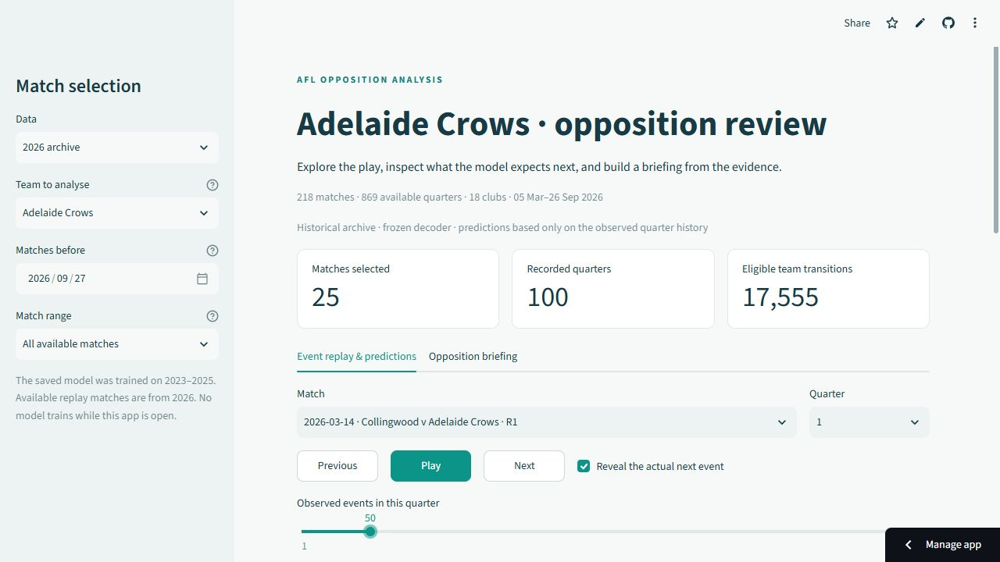
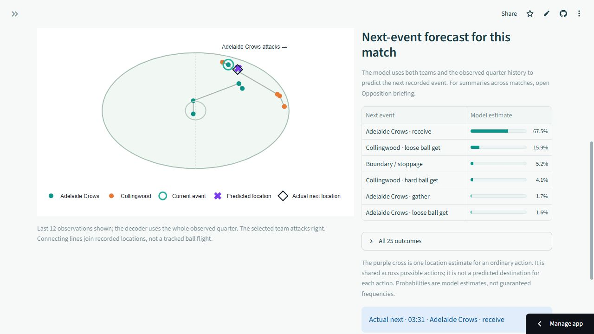

# AFL Opposition Analysis

**[Open the live app](https://afl-opposition-analysis.streamlit.app/)** — no installation or sign-in required.

Explore how AFL teams move the ball, compare model forecasts with what happened next, and download an opposition briefing. This independent project combines match-event replays, observed team tendencies and machine learning in one browser app.

The app includes the full prepared **2026 archive: 218 matches, 869 available quarters and all 18 clubs**, spanning 5 March to 26 September 2026.

## Try the app

1. **Choose a team and match.** All available matches are shown by default. Use the sidebar to select a team or limit the review to recent games, then choose a match and quarter.
2. **Inspect the play.** Step through events or press Play. Compare the predicted next team, action and location with the recorded outcome. **Reveal the actual next event** is checked by default and can be turned off.
3. **Download a briefing.** Open **Opposition briefing**, review the tendency table and generate an HTML report that can be opened offline or printed to PDF.

*Full-archive view: Adelaide's 25 matches and 100 quarters are available for review. Select any club, then choose a match and an available quarter.*

*One successful example from the same replay: Collingwood v Adelaide Crows, 14 March 2026, quarter 1, after event 50. The model assigns 67.5% to an Adelaide receive, which is recorded at 03:31. The location markers nearly overlap. This illustration was selected to show a correct prediction; overall performance is summarised below.*

## What can an analyst explore?

| Question | What the app provides |
| --- | --- |
| What usually follows this team's actions in different parts of the ground? | Recorded next-action frequencies, grouped by the current action and field third. |
| What does the model expect next in this passage? | Probabilities for the next team and action, plus a predicted event location. |
| How does that compare with what happened? | The recorded next event and location alongside the forecast. |
| What can be shared for further review? | A downloadable briefing with match coverage, tendency tables and example passages. |

The aim is to bring patterns and supporting match evidence together for an analyst to investigate. The forecasts add an estimate based on the sequence of play, alongside the descriptive statistics.

## Results at a glance

Across **333,883 eligible next-event examples** from the 2026 archive:

| Method | Correct next team/action or stoppage |
| --- | ---: |
| Simple baseline based on the current event | 57.86% |
| Tuned decoder-only Transformer | **63.61%** |

The Transformer result averages three training runs. The app uses one of those models, chosen before evaluation. Its location predictions also improved on the baseline. [Full results and definitions](docs/decoder-evaluation.md).

Models were developed using 2023–2025 data. The 2026 results are a previously reviewed research benchmark, not a prospective live-match test. Rare actions remain harder to predict.

## Scope

This is a **historical review demo**. Three quarters are excluded because their event timestamps run backwards; the app shows the available coverage. Replays plot recorded events rather than video or continuous player tracking. The project has not established that its forecasts improve coaching decisions. Separate shot and goal prediction experiments are available in the notebooks and are not yet part of the app.

## Explore the work

- **[Decoder evaluation — Notebook 15](notebooks/15_decoder_evaluation.ipynb):** model comparisons, prediction errors and results across three training runs.
- **[Sequence modelling — Notebook 13](notebooks/13_event_formulations.ipynb):** how event history and team context become next-event predictions.
- **[Shot and goal prediction — Notebook 11](notebooks/11_transformer_retraining.ipynb):** the separate possession-outcome experiments.
- **[App guide](docs/app.md):** local installation, report interpretation and hosting.
- **[Technical guide](docs/technical-guide.md):** detailed benchmarks, data preparation and reproduction commands.

Notebooks include saved outputs for reading directly on GitHub. The project uses Python, pandas, PyTorch, Streamlit and Plotly. Data comes from the public [torpdata match-event archive](https://github.com/peteowen1/torpdata/releases/tag/chains-data), with source versions and checksums recorded in the repository.

## AI-assisted development

Developed by Bastian Oetomo with OpenAI Codex assisting with implementation, debugging, tests and documentation. Bastian directed the analytical questions, model comparisons and evaluation approach, and reviewed the code and results. The repository retains executed notebooks, automated checks and documented limitations to make the work reviewable.
