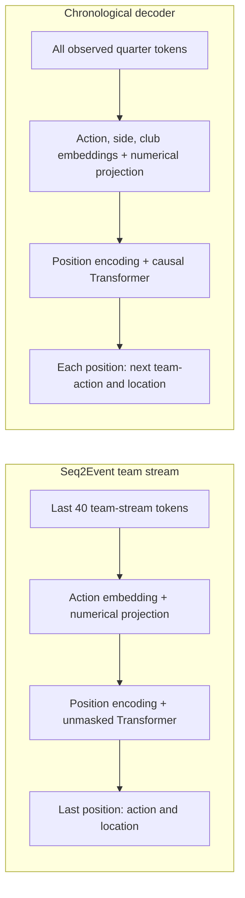

# Two formulations of next-event prediction

The experiment compares a Seq2Event team-stream model with a causal, decoder-only Transformer over chronological AFL quarter events. They have different targets and information sets. This is a comparison of modelling formulations, not a controlled ablation or a direct leaderboard.

The earlier within-possession experiment remains available in [notebook 12](../notebooks/12_next_event_prediction.ipynb). This experiment has separate source modules, checkpoints and reports.

## Questions and targets

| | Seq2Event team stream | Chronological decoder |
| --- | --- | --- |
| Question | What is the next attacking action in this team's stream, and where? | Which team performs the next recorded ball-control action, what is it, and where? |
| Stream | A team's actions, with possession-boundary markers | Both teams' actions, observed stoppages and restarts |
| Context | Last 40 stream tokens; early prefixes with fewer tokens are skipped | Every observed token since the quarter began |
| Team information | No team embedding or output; team is implicit in the selected stream | Acting-side and home/away club embeddings; next acting side is predicted |
| Attention | Unmasked over the fully observed window | Causal; position t cannot attend to t+1 or later |
| Output | Action logits and a point location | Joint team-action logits, a neutral boundary class, and a point location |
| Shared parameters | One model across all teams | One model across all teams |

For example, a chronological sequence `A kick, A mark, B gather, B handball, A gather, A kick` becomes `kick, mark, boundary, gather, kick` in A's filtered stream. B's intervening actions are absent. The chronological model instead predicts `B gather` after `A mark`.

The chronological vocabulary contains the twelve ball-control actions for each side, plus a neutral boundary class: 25 output classes. Boundaries have no acting team or location. A separate gap token represents unresolved raw actions in the input and is never a supervised output. A generic boundary does not distinguish goals, behinds, stoppages or restarts.

The numerical input at each token contains position, quarter time and number, coordinate availability, time and position differences, and distance/bearing to the acting team's attacking goal. The team-stream model uses its focal team's attacking frame. The chronological model uses a consistent home-attacking frame within each quarter. Position differences adjacent to tokens without coordinates are zero. Boundary and gap coordinate placeholders are accompanied by a coordinate-availability feature and are never scored as physical locations.

Final scores, shot flags, possession outcomes and future tokens are not model inputs. The `kick` action includes archived kicks at goal. A running score and explicit shot-action taxonomy are omitted pending further data attribution work.

## Mathematical formulation

In the team-stream model, let `u_m = (a_m, c_m)` be item m in one team's filtered stream. The model receives `u_(m-39), ..., u_m` and predicts action `a_(m+1)` and location `(x_(m+1), y_(m+1))`. Those indices refer to the filtered stream, not the original match timeline. Action embeddings and a linear projection of continuous inputs are concatenated, positional encoding is added, and an unmasked Transformer encoder processes the window. A linear–ReLU–linear head reads the last position.

In the chronological model, let `e_t = (s_t, a_t, c_t)` contain acting side, action and numerical context. Club IDs provide additional match context. A causal representation at t uses only `e_1, ..., e_t`. Its head predicts a joint categorical distribution over `(s_(t+1), a_(t+1))` and a point location, or a boundary event. Joint probabilities can be marginalised to obtain team and action probabilities. A single forward pass supervises all eligible next-token positions in the quarter. No fixed context cap or sliding-window truncation is applied. Padding masks prevent shorter quarters from attending to padded tokens.

Neither model predicts every numerical context field or implements free-running multi-step match simulation. The location output is one point conditional on an ordinary continuation, not an action-specific spatial distribution. Multiple plausible next locations can therefore be averaged.



## Fidelity to Seq2Event

Reference: Simpson, Beal, Locke and Norman, [Seq2Event, KDD 2022](https://doi.org/10.1145/3534678.3539138). The [released modelling notebook](https://github.com/statsonthecloud/Soccer-SEQ2Event/blob/main/Seq2Event_Notebook02_Modelling.ipynb) supplies the implementation reference.

The team-stream model preserves the principal construction: separate team streams, possession markers, fixed windows, action embedding plus linear numerical projection, positional encoding, unmasked post-normalisation Transformer blocks with ReLU, last-position readout and the action/location head. Encoder layers follow the original cloned initialisation. Adam with L2 regularisation is used.

The objective follows the released code's reduction:

```text
5 × mean(weight[target] × categorical cross-entropy)
  + RMSE over valid coordinate targets
```

The mean divides by the number of eligible examples, not the sum of class weights. The boundary class has weight zero. Coordinate loss excludes boundary targets and predictions immediately following a boundary, as in the authors' implementation. Thus this model is not trained to estimate turnover probability. For action reporting, the boundary logit is removed and probabilities are renormalised over the twelve ordinary actions.

Necessary, explicit adaptations are:

- The dataset is AFL rather than Wyscout soccer. Twelve audited AFL action types replace the soccer vocabulary. Possession boundaries follow this repository's documented rules.
- Inverse-frequency weights are estimated from the fitting partition and normalised to sum to one across supported AFL actions. Soccer-specific numerical weights are not copied. The final refit recomputes these weights from training plus validation data. Weighted-training probabilities are not assumed to be calibrated natural-frequency probabilities.
- Ten audited AFL numerical features replace the soccer feature list. Numeric standardisation is fitted on training data, and refitted for the final model.
- Histories stop at quarter boundaries, and uncertain passages are represented explicitly. The original team aggregation and split protocol are not replicated exactly.
- Standard paired sinusoidal positional encoding is used. The released notebook's different channel-index/base implementation is not copied.
- Chronological season partitions and a bounded validation search replace the original soccer evaluation protocol.

This is a faithful implementation of the central Seq2Event architecture and loss structure adapted to AFL. It is not a claim to reproduce the paper's results or to match every line of its released code.

## Data quality and boundaries

The loader verifies the existing pinned raw snapshots and preprocessing provenance. Team IDs must match the home/away metadata. Missing numerical inputs, ambiguous ordering and time reversals fail explicitly rather than silently shortening history.

Reviewed processed actions remain visible in history, but transitions touching reviewed tokens are not scored. Unresolved raw actions become gap tokens; no supervised pair jumps over a gap. Stoppage/restart tokens use their observed annotation times. A possession ending is not inserted early based on a future endpoint label. Quarter-final observations have no next-event target; the absence of another archived event is not treated as an observed end-of-quarter label.

Eligibility is a retrospective archive-quality filter, not an input available live. It can bias results towards cleaner passages. Keeping uncertain observations as history does not make them reliable observations. The archive's live availability and revision latency have not been verified.

## Selection, refitting and evaluation

Both formulations follow the same schedule:

1. Fit encoders, model parameters and task-specific transition baselines on 2023–2024.
2. Screen four configurations for two epochs using 2025 validation loss. Continue the best two up to twelve epochs, with patience three.
3. Select the configuration and best epoch count independently for each task.
4. Fit fresh encoders and models on 2023–2025 for the selected epoch counts.
5. Export and reload both frozen models before loading 2026.
6. Evaluate the models and their task-matched transition baselines without updating weights.

The bounded single-seed search compares widths 64/96/128, one/two layers, action embedding dimensions 8/16/32, dropout 0.1/0.25 and learning rates 0.001/0.0003. These combinations are not a full Cartesian grid. Both use two attention heads, feed-forward width four times the model width, a 64-unit prediction head and Adam L2 weight decay 0.0001. Seq2Event uses the same 40-token window for every candidate, keeping its candidate target rows identical. The decoder has no history-length hyperparameter.

Decoder selection uses ordinary joint cross-entropy with coefficient five plus masked location RMSE. Seq2Event selection uses its weighted objective. Raw losses across the two formulations are not comparable. The training log's batch-average objective is distinct from the validation objective calculated over the whole validation partition.

Each task reports its own transition baseline, confusion matrices, precision/recall/F1 by class, log loss, accuracy, Brier score and normalised location error. Macro F1 is reported both over the fixed vocabulary and over classes with nonzero support. Decoder team/action marginals are labelled as conditional diagnostics on true ordinary-action targets. The full joint confusion matrix includes boundary errors and is the primary categorical evaluation.

2026 is an already-observed project benchmark. It is excluded from this search and refit, but is not an untouched confirmatory holdout. Results do not establish real-match deployment readiness or causal effects of team identity or masking.

## Run the experiment

Prepare the pinned seasons using the main README. The existing `[model,sequence,notebook]` extras provide the required packages. From the repository root:

```powershell
.\.venv\Scripts\python.exe -m afl_opposition.event_comparison --audit-only
.\.venv\Scripts\python.exe -m afl_opposition.event_comparison --smoke
.\.venv\Scripts\python.exe -m afl_opposition.event_comparison
.\.venv\Scripts\python.exe -m afl_opposition.event_comparison_report
```

The smoke run checks engineering on two whole matches per development season and never loads 2026. Its scores are not model-performance evidence. Full results go to `artifacts/event-comparison-v1/`. Add `--resume` to continue an interrupted run with unchanged code, data and settings. Checkpoints include optimiser and random states. Completed experiments cannot be overwritten; use a new `--output` for another run.

The exporter creates compact public reports in `reports/examples/event-comparison-v1/`, including a predetermined first-test-quarter forecast. Add `--overwrite` only when deliberately replacing that report. Weights and full prediction tables remain local. [Notebook 13](../notebooks/13_event_formulations.ipynb) reads the compact reports without raw archives or model weights.

For inference, load a model with `afl_opposition.event_models.load_model` and call `forecast_next` with observed quarter tokens from `build_quarters`. The decoder consumes the entire prefix. Seq2Event also requires `focal_side=0` (home) or `1` (away), and at least 40 tokens in that team's filtered stream. The inference call does not require target labels.

## Verification

```powershell
.\.venv\Scripts\python.exe -m unittest discover -s tests -v
```

Tests cover acting-team attribution, coordinate conversion, observed turnover markers, quarter separation, missing-passage handling, future-invariant inputs, causal prefix equivalence, padding, fixed/full histories, ignored-boundary gradients, train-only preprocessing, checkpoint integrity, deterministic resume, tiny-data learning and the requirement that both models are frozen before the test loader is called.
